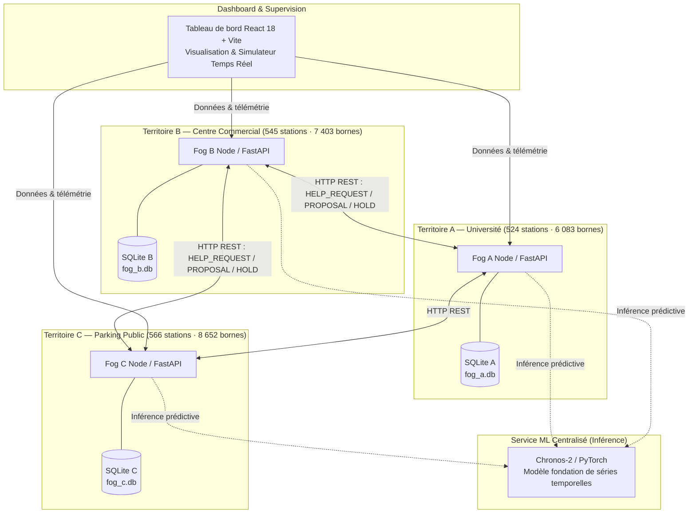
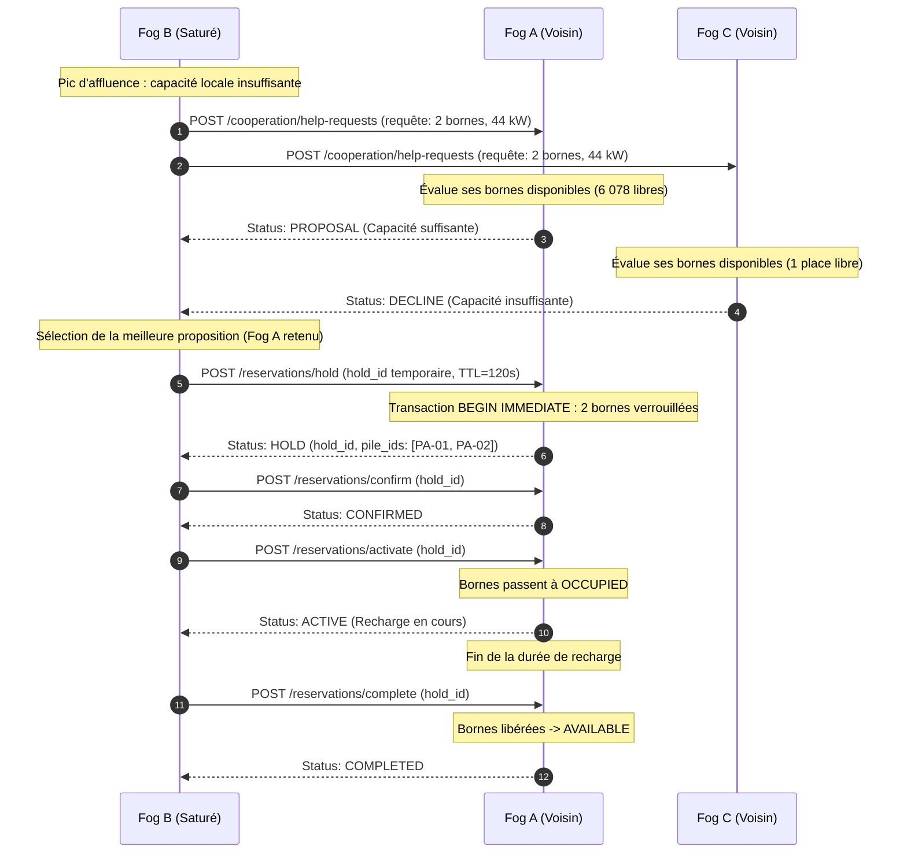
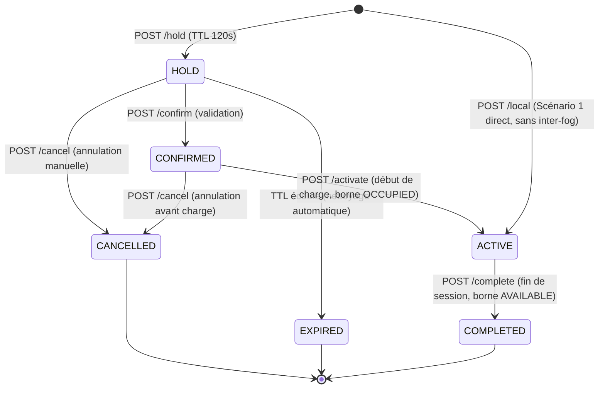
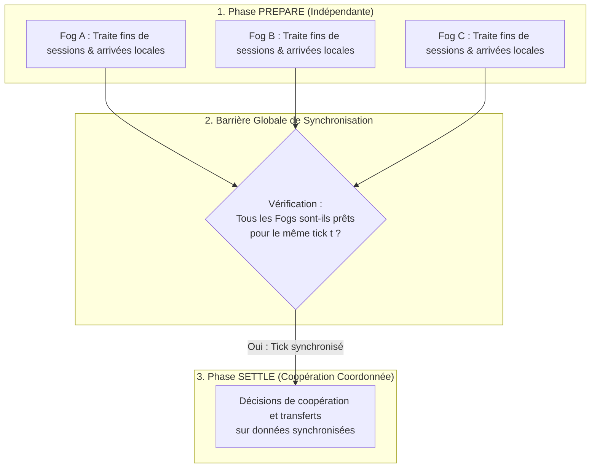

# Multi-Fog EV — Réseau de Recharge Collaboratif & Intelligent

> Prototype académique et opérationnel d'un réseau de recharge pour véhicules électriques organisé en **territoires Fog autonomes**, capables de prendre des décisions locales indépendantes et de **coopérer directement d'égal à égal (Fog-to-Fog)** sans dépendre d'un serveur central, enrichi par des prévisions de demande par zone avec **Chronos-2**.

**Dépôt GitHub :** [https://github.com/mariemammar1/Multi-fog-project](https://github.com/mariemammar1/Multi-fog-project)

---

## Sommaire

1. [Vision du projet](#1-vision-du-projet)
2. [Architecture territoriale & Propriété des données](#2-architecture-territoriale--propriété-des-données)
3. [Technologies utilisées](#3-technologies-utilisées)
4. [Communication Fog-to-Fog & Négociation de ressources](#4-communication-fog-to-fog--négociation-de-ressources)
5. [Cycle de vie complet d'une réservation (Protocole V7)](#5-cycle-de-vie-complet-dune-réservation-protocole-v7)
6. [Les 7 Scénarios de Communication et Coopération](#6-les-7-scénarios-de-communication-et-coopération)
7. [Synchronisation globale par rounds : PREPARE / SETTLE](#7-synchronisation-globale-par-rounds--prepare--settle)
8. [Prévisions de demande Chronos-2](#8-prévisions-de-demande-chronos-2)
9. [Tableau de bord React & Simulateur interactif](#9-tableau-de-bord-react--simulateur-interactif)
10. [Catalogue d'API REST](#10-catalogue-dapi-rest)
11. [Installation et Démarrage](#11-installation-et-démarrage)
12. [Tests et Validation](#12-tests-et-validation)
13. [Structure du projet](#13-structure-du-projet)
14. [Données réelles et Références](#14-données-réelles-et-références)

---

## 1. Vision du projet

Le déploiement massif des véhicules électriques (EV) engendre des pics de demande localisés qui saturent les réseaux de recharge traditionnels. Les architectures cloud centralisées souffrent de latences élevées, d'une dépendance critique à la connectivité Internet et d'un manque de scalabilité territoriale.

Le projet **Multi-Fog EV** résout ce défi en découpant le réseau en **territoires géographiques autonomes (Fog Nodes)** :
- Chaque Fog administre en totale souveraineté ses propres stations, ses bornes, son historique et sa base de données locale.
- **En fonctionnement normal (Scénario 1)** : les décisions d'attribution et de recommandation sont 100 % locales, indépendantes et sans communication inter-fog.
- **En cas de forte affluence ou de saturation locale (Scénarios 2 à 4)** : le Fog saturé négocie directement avec ses pairs voisins via un protocole en 4 étapes (`HOLD` → `CONFIRM` → `ACTIVATE` → `COMPLETED`) pour délester les véhicules sans transférer la propriété de ses bornes à une autorité centrale.
- **En cas de saturation globale (Scénario 6)** : le réseau refuse proprement les transferts, empêchant toute création de sessions de recharge fictives (*zero ghost session*).
- **Prédiction proactive (Scénario 7)** : les prévisions de demande par zone issues du modèle fondation **Chronos-2** anticipent la charge sans pré-bloquer inutilement les ressources.

---

## 2. Architecture territoriale & Propriété des données

Le réseau modélise l'agglomération de Shenzhen à partir du jeu de données réel **UrbanEV**, réparti entre 3 nœuds Fog :

| Fog Node | Identifiant (`FOG_ID`) | Territoire (`FOG_ZONE`) | Caractéristiques réelles | Responsabilité locale |
|---|---|---|---|---|
| **Fog A** | `fog-a` | Université (`university`) | **524 stations** · **6 083 bornes** | Quartier académique & tech (Nanshan / Futian) |
| **Fog B** | `fog-b` | Centre commercial (`shopping_center`) | **545 stations** · **7 403 bornes** | Pôle commercial & forte variabilité (Luohu / Longgang) |
| **Fog C** | `fog-c` | Parking public (`public_parking`) | **566 stations** · **8 652 bornes** | Grand parking de transit (Bao'an / Qianhai) |
| **Total Réseau** | — | **3 Territoires** | **1 635 stations** · **22 138 bornes** | **Réseau multi-fog collaboratif** |

### Principe fondamental : Souveraineté locale des données

1. **Aucun accès direct aux bases distantes** : Fog A ne peut ni lire ni modifier directement la base `fog_b.db` ou `fog_c.db`.
2. **Communication REST exclusive** : Toutes les interactions inter-territoires se font par requêtes HTTP sécurisées sur les API des Fog pairs (`FOG_A_URL`, `FOG_B_URL`, `FOG_C_URL`).
3. **Le Fog propriétaire décide toujours** : Un Fog sollicité évalue lui-même ses ressources disponibles et réserve ses propres bornes dans sa propre base SQLite.



---

## 3. Technologies utilisées

- **Backend Fog** : Python 3.12 / 3.13, FastAPI, Uvicorn, Pydantic v2.
- **Client HTTP inter-fog** : HTTPX (appels asynchrones et synchrones avec gestion des timeouts et failover).
- **Stockage & Concurrence** : SQLite3 avec transactions immédiates (`BEGIN IMMEDIATE`) et index partiels d'exclusion unique.
- **Machine Learning & Prévision** : Chronos-2 (`amazon/chronos-bolt-small` / PyTorch, Hugging Face) pour les prévisions probabilistes de charge par zone.
- **Tableau de Bord & IHM** : React 18, TypeScript, Vite, Tailwind CSS, Lucide Icons, Leaflet (carte interactive géolocalisée).
- **Conteneurisation** : Docker & Docker Compose (isolation des 3 Fogs et du service Chronos-ML avec volumes de données distincts).
- **Tests & Qualité** : Pytest (53 tests unitaires et d'intégration validés), Node test runner (`npm test` : 14 tests frontend validés).

---

## 4. Communication Fog-to-Fog & Négociation de ressources

### 4.1 Découverte des pairs

Les adresses des nœuds voisins sont injectées par variables d'environnement (`FOG_A_URL`, `FOG_B_URL`, `FOG_C_URL`). Le service `peer_communication_service.py` exclut systématiquement le nœud émetteur pour éviter qu'un Fog ne se sollicite lui-même.

### 4.2 Protocole de demande d'aide



### 4.3 Classement et sélection des propositions

Le service `proposal_selection_service.py` filtre les réponses des pairs pour ne retenir que celles respectant le nombre de bornes et la puissance minimale requise. Le classement s'opère selon :
1. **Le nombre de bornes disponibles** (ordre décroissant).
2. **La puissance totale disponible** (critère secondaire de départage).

### 4.4 Résilience et basculement automatique (Failover)

Si le Fog retenu ne peut finalement pas honorer la réservation lors de l'appel au `HOLD` (par exemple conflit de concurrence HTTP `409`, timeout ou déconnexion réseau), le demandeur bascule automatiquement vers la proposition suivante dans le classement.

---

## 5. Cycle de vie complet d'une réservation (Protocole V7)

Toutes les réservations ciblent des **bornes individuelles (`pile_id`)** et non des stations globales, permettant une granularité fine.



### Endpoints exposés sous `/api/v1/reservations`

| Endpoint | Méthode | Rôle fonctionnel | Statut résultant |
|---|---|---|---|
| `/local` | `POST` | **Scénario 1** : Demande locale directe d'un véhicule sur son Fog | `ACTIVE` |
| `/hold` | `POST` | Étape 1 du protocole V7 : Réservation temporaire avec TTL | `HOLD` |
| `/confirm` | `POST` | Étape 2 du protocole V7 : Confirmation du blocage | `CONFIRMED` |
| `/activate` | `POST` | Étape 3 du protocole V7 : Démarrage effectif (borne `OCCUPIED`) | `ACTIVE` |
| `/complete` | `POST` | Étape 4 du protocole V7 : Clôture de session (borne `AVAILABLE`) | `COMPLETED` |
| `/cancel` | `POST` | Annulation manuelle d'un HOLD ou d'une session confirmée | `CANCELLED` |

### Protection stricte contre les doubles réservations

Le système implémente une double barrière anti-concurrence :
1. **Verrouillage transactionnel** : Requête SQLite `BEGIN IMMEDIATE` dans [reservation_repository.py](file:///d:/Multi-Fog-EV/fog/repositories/reservation_repository.py) pour empêcher deux écritures simultanées.
2. **Index partiel unique SQLite** :
   ```sql
   CREATE UNIQUE INDEX unique_active_pile_reservation
   ON reservations(pile_id)
   WHERE status IN ('HOLD', 'CONFIRMED', 'ACTIVE');
   ```
   Toute tentative concurrente d'allouer une même borne lève immédiatement une `sqlite3.IntegrityError` rejetée avec un code HTTP `409 Conflict`.

---

## 6. Les 7 Scénarios de Communication et Coopération

Le projet implémente et teste rigoureusement les **7 scénarios** définis par le cahier des charges :

| Scénario | Situation | Mécanismes et règles d'implémentation | Fichiers & Tests de validation |
|---|---|---|---|
| **S1 — Communication locale Véhicule $\leftrightarrow$ Fog** | Disponibilité locale suffisante dans chaque zone. | Le véhicule s'adresse au Fog de son territoire (`POST /api/v1/reservations/local`). Le Fog vérifie sa capacité locale et affecte directement une borne en session `ACTIVE` (borne mise à `OCCUPIED`). **Zéro appel inter-fog, zéro requête réseau.** | `fog/repositories/reservation_repository.py`<br/>`tests/unit/test_v7_scenarios.py`<br/>`dashboard/verify_scenario1.ts` |
| **S2 — Demande d'aide inter-Fog** | Fog B saturé face à un afflux de véhicules. | Fog B diffuse une `HELP_REQUEST` aux Fog A et C. Ceux-ci évaluent leurs bornes locales et renvoient `PROPOSAL` ou `DECLINE`. Fog B retient la meilleure proposition. | `fog/api/cooperation.py`<br/>`fog/services/proposal_selection_service.py`<br/>`tests/unit/test_proposal_selection.py` |
| **S3 — Réservation temporaire (HOLD)** | Négociation des ressources avant confirmation. | Fog B envoie une requête `HOLD` avec TTL (120 s) au Fog retenu (Fog A). Fog A verrouille les bornes requises de manière atomique. | `fog/api/reservations.py`<br/>`fog/repositories/reservation_repository.py` |
| **S4 — Cycle de vie V7 complet (Transfert et Activation)** | Transfert de charge inter-territoires de bout en bout. | Protocole en 4 phases : `HOLD` → `CONFIRM` → `ACTIVATE` (borne passe à `OCCUPIED`) → `COMPLETED` (borne repasse à `AVAILABLE`). Garantie d'idempotence et interdiction d'activer un hold non confirmé. | `tests/unit/test_v7_scenarios.py` (classe `TestScenario4LifecycleV7`) |
| **S5 — Synchronisation distribuée (PREPARE / SETTLE)** | Éviter les décisions sur des données désynchronisées. | Découpage par cycles/ticks avec barrière globale : chaque Fog exécute sa phase `PREPARE` (clôtures et arrivées locales), l'orchestrateur s'assure que les 3 Fogs sont au même tick, puis déclenche `SETTLE` pour coopérer sur les véhicules résiduels. | `simulator/orchestrator.py`<br/>`fog/services/round_service.py`<br/>`tests/unit/test_orchestrator.py` |
| **S6 — Saturation de tous les Fogs** | Aucun Fog voisin ne possède de ressources libres (ex: tous à 20/20 ou 100%). | Fog B consulte ses pairs ; tous répondent `DECLINE`. **Aucune coopération n'est possible, les véhicules restent non servis au niveau réseau et strictement AUCUNE recharge ou réservation fictive n'est créée (0 ghost session).** | `tests/test_v7_saturation.py`<br/>`tests/unit/test_v7_scenarios.py` |
| **S7 — Prédiction ML Chronos-2 & Coopération réactive** | Anticiper la demande sans bloquer inutilement les bornes. | Le modèle ML Chronos-2 prédit la demande future à titre informatif (**0 borne réservée à l'avance**). La coopération ne se déclenche que réactivement au tick suivant si les arrivées réelles dépassent la capacité locale. | `tests/unit/test_orchestrator.py`<br/>`tests/unit/test_v7_scenarios.py`<br/>`ml-service/` |

---

## 7. Synchronisation globale par rounds : PREPARE / SETTLE

Pour éviter que Fog B ne choisisse Fog C sur la base d'une capacité obsolète avant que C n'ait traité ses propres arrivées, le projet fournit un protocole de synchronisation distribuée en deux temps :



Les endpoints correspondants sont exposés sur chaque nœud sous `/api/v1/round` :
- `POST /api/v1/round/prepare` : initialise le tour, libère les sessions terminées et alloue les véhicules locaux.
- `POST /api/v1/round/settle` : accepte les transferts de pairs et déclenche la coopération pour les véhicules restants.
- `GET /api/v1/round/status` : consulte la phase en cours (`IDLE`, `PREPARED`, `SETTLED`) et le tick d'horloge.

---

## 8. Prévisions de demande Chronos-2

Le service de Machine Learning s'appuie sur le modèle fondation **Chronos-2** d'Amazon pour prévoir l'occupation des bornes par territoire :

- **Entrée** : Série temporelle des 12 dernières heures d'occupation observées (`ml-service/data/fog-*.csv`).
- **Sortie** : Prédictions probabilistes aux quantiles `q10` (scénario bas), `q50` (médiane) et `q90` (scénario haut) avec un horizon de 60 minutes.
- **Précision validée** :
  - Fog A : MAE de **32.36** (gain face à la baseline de 34.54).
  - Fog B : MAE de **45.12** (gain face à la baseline de 48.90).
  - Fog C : MAE de **39.80** (gain face à la baseline de 42.15).

---

## 9. Tableau de bord React & Simulateur interactif

Le dossier `dashboard/` contient une interface web moderne, intuitive et réactive conçue pour les conducteurs d'EV et les opérateurs réseau.

### 4 Vues spécialisées

1. ⚡ **Trouver une Borne (Recommandation)** :
   - Classement multi-critères selon la position du conducteur : temps de trajet (45 %), occupation prévue (35 %) et temps d'attente estimé (20 %).
   - **Filtres 1-clic rapides** : Recharge Rapide DC, Disponibles uniquement, Rayon kilométrique.
   - **Sélecteur de zone transparent** : Navigation instantanée entre Fog A (Centre), Fog B (Commercial) et Fog C (Ouest).
   - **Volet expert repliable** : Affiche les pondérations et les métriques ML détaillées sans surcharger l'utilisateur novice.
2. 🗺️ **Carte des Bornes (Leaflet)** :
   - Affichage géolocalisé interactif des **1 635 stations réelles** du réseau avec leur statut en direct (vert = libre, orange = sollicité, rouge = saturé).
   - Calcul d'itinéraire et guidage simulé.
3. 📊 **Prévisions IA (Chronos-2)** :
   - Jauges d'occupation prédictive, courbes d'évaluation 24h et comparaison Chronos-2 vs Baseline historique.
4. 🎮 **Simulateur Temps Réel (Console de Contrôle)** :
   - Commandes : ▶ **Démarrer**, ⏸ **Pause**, ⏭ **Pas suivant (+1 Tick)**, ↺ **Réinitialiser**.
   - Sélecteur de scénarios en 1 clic : **S1 Normal**, **S2-S4 Coopération V7**, **S6 Saturation Globale**, **S7 Prédiction Réactive**.
   - Boutons de stress-test : Injection manuelle de trafic (`+10 EV`, `+25 EV`, `+50 EV`).
   - Journal de streaming affichant en temps réel chaque transaction (affectation locale, hold, confirmation, terminaison).

---

## 10. Catalogue d'API REST

Chaque nœud Fog expose les endpoints suivants sur son port respectif (`18001`, `18002`, `18003`) :

| Catégorie | Méthode | Route | Description |
|---|---|---|---|
| **Santé & Identité** | `GET` | `/health` | Diagnostic de santé du nœud |
| | `GET` | `/api/v1/status` | Identité, zone et état opérationnel |
| **Stations & Bornes** | `GET` | `/api/v1/stations` | Liste des stations et statut agrégé |
| | `GET` | `/api/v1/stations/capacity` | Capacité totale et bornes libres du territoire |
| | `GET` | `/api/v1/piles` | Liste détaillée des bornes individuelles (puissance, type AC/DC, état) |
| | `GET` | `/api/v1/piles/capacity` | Capacité en temps réel des bornes et puissance disponible en kW |
| | `GET` | `/api/v1/piles/station-capacities` | Disponibilité groupée par station |
| | `PATCH` | `/api/v1/piles/{pile_id}/status` | Mise à jour manuelle de l'état d'une borne |
| **Coopération Inter-Fog** | `POST` | `/api/v1/cooperation/help-requests` | Évaluer une demande d'aide d'un Fog voisin (`PROPOSAL` ou `DECLINE`) |
| | `POST` | `/api/v1/cooperation/request-help` | Initier une négociation d'aide vers les pairs |
| **Réservations V7** | `POST` | `/api/v1/reservations/local` | **S1** : Traiter une demande locale sans coopération (`ACTIVE`) |
| | `POST` | `/api/v1/reservations/hold` | **S3** : Poser un blocage temporaire avec TTL |
| | `POST` | `/api/v1/reservations/confirm` | **S4** : Confirmer une réservation temporaire |
| | `POST` | `/api/v1/reservations/activate` | **S4** : Démarrer la session de recharge (`OCCUPIED`) |
| | `POST` | `/api/v1/reservations/complete` | **S4** : Clôturer la recharge et libérer la borne (`AVAILABLE`) |
| | `POST` | `/api/v1/reservations/cancel` | Annuler une réservation temporaire ou confirmée |
| **Rounds Distribués (S5)** | `POST` | `/api/v1/round/prepare` | Exécuter la phase locale PREPARE |
| | `POST` | `/api/v1/round/settle` | Exécuter la phase coordonnée SETTLE |
| | `GET` | `/api/v1/round/status` | Statut du tour et capacité synchronisée |
| **Prévisions Chronos-2** | `GET` | `/api/v1/forecasts` | Prévision d'occupation à 60 minutes via Chronos-2 |
| **Simulateur Temps Réel** | `GET` | `/api/v1/simulator/status` | État d'avancement du simulateur et statistiques |
| | `POST` | `/api/v1/simulator/start` | Démarrer la boucle de simulation automatique |
| | `POST` | `/api/v1/simulator/stop` | Suspendre la simulation |
| | `POST` | `/api/v1/simulator/step` | Avancer d'exactement un tick |
| | `POST` | `/api/v1/simulator/scenario` | Définir le scénario actif (`S1_NORMAL`, `S2_COOPERATION`, etc.) |
| | `POST` | `/api/v1/simulator/inject` | Injecter un afflux artificiel de véhicules |
| | `POST` | `/api/v1/simulator/reset` | Réinitialiser les bases de données à 100 % disponible |
| | `GET` | `/api/v1/fogs/overview` | Vue consolidée des 3 bases SQLite |

---

## 11. Installation et Démarrage

### Option A : Déploiement complet avec Docker Compose (Recommandé)

Prérequis : Docker et Docker Compose installés.

```bash
# 1. Cloner le projet
git clone https://github.com/mariemammar1/Multi-fog-project.git
cd Multi-fog-project

# 2. Lancer les 3 Fog Nodes et Chronos-2
docker compose up --build -d

# 3. Vérifier que tous les services sont sains
docker compose ps
```

Documentation Swagger interactive :
- **Fog A (Université)** : [http://localhost:18001/docs](http://localhost:18001/docs)
- **Fog B (Centre Commercial)** : [http://localhost:18002/docs](http://localhost:18002/docs)
- **Fog C (Parking Public)** : [http://localhost:18003/docs](http://localhost:18003/docs)
- **Service Chronos-2** : [http://localhost:8000/docs](http://localhost:8000/docs)

### Option B : Lancement local sans Docker (Développement)

Prérequis : Python 3.12+ et Node.js 18+.

```powershell
# 1. Configurer l'environnement virtuel Python
python -m venv .venv
.\.venv\Scripts\Activate.ps1
pip install -r requirements.txt

# 2. Lancer le simulateur en ligne de commande (exemple : scénario coopération S2)
$env:PYTHONPATH="."
python run_realtime_simulation.py --scenario S2_COOPERATION --ticks 15 --interval 1.0

# 3. Lancer le Dashboard React
cd dashboard
npm install
npm run dev
```

Accéder au tableau de bord : [http://localhost:5173](http://localhost:5173).

---

## 12. Tests et Validation

Le projet intègre une suite de tests complète validant les protocoles de réservation, la concurrence, la synchronisation distribuée et l'absence de réservations fictives :

### Exécuter la suite de tests Python (53 tests)

```powershell
$env:PYTHONPATH="."
pytest tests/unit tests/test_v7_saturation.py tests/test_database_constraint.py -v
```

**Bilan des 53 tests unitaires et d'intégration :**
- `test_v7_scenarios.py` (12 tests) : validation in-process du cycle S1 direct, du protocole V7 (`HOLD` → `CONFIRM` → `ACTIVATE` → `COMPLETED`), de l'idempotence et de l'absence d'appels réseau en S1.
- `test_orchestrator.py` (10 tests) : synchronisation distribuée PREPARE / barrière / SETTLE, libération de bornes par complétion, accumulation d'historique.
- `test_simulator_engine.py` (6 tests) : moteur temps réel, injection de trafic, transition des scénarios et reset SQLite.
- `test_proposal_selection.py` (7 tests) : filtrage et classement des offres selon capacité et puissance.
- `test_reservation_repository.py` (13 tests) : atomicité des transactions SQLite et gestion des TTL.
- `test_v7_saturation.py` (4 tests) : saturation réseau S6 et vérification absolue de **zéro recharge fictive**.
- `test_database_constraint.py` (1 test) : intégrité de l'index d'exclusion unique SQLite.

### Exécuter les tests du Dashboard Frontend (14 tests)

```bash
cd dashboard
npm test
npm run build
```

---

## 13. Structure du projet

```text
Multi-Fog-EV/
├── data/                               # Bases de données SQLite locales réelles
│   ├── fog_a.db                        # 524 stations, 6 083 bornes (Zone Université)
│   ├── fog_b.db                        # 545 stations, 7 403 bornes (Zone Commerciale)
│   └── fog_c.db                        # 566 stations, 8 652 bornes (Zone Parking)
├── docker-data/                        # Volumes de données persistants Docker
├── fog/                                # Cœur applicatif des nœuds Fog
│   ├── api/                            # Routes FastAPI modulaires
│   │   ├── cooperation.py              # Endpoints HELP_REQUEST et request-help (S2)
│   │   ├── forecast.py                 # Endpoint d'inférence Chronos-2
│   │   ├── main.py                     # Point d'entrée de l'application FastAPI
│   │   ├── piles.py                    # Gestion des bornes individuelles
│   │   ├── reservations.py             # Protocole V7 (hold, confirm, activate, complete, local)
│   │   ├── round.py                    # Endpoints PREPARE / SETTLE (S5)
│   │   ├── simulator.py                # Contrôles de simulation temps réel
│   │   └── stations.py                 # Catalogue des stations
│   ├── repositories/                   # Couche d'accès aux données SQLite
│   │   ├── pile_repository.py          # Requêtes SQL de disponibilité des bornes
│   │   ├── reservation_repository.py   # Transactions atomiques BEGIN IMMEDIATE & TTL
│   │   └── station_repository.py       # Agrégation géographique des stations
│   ├── services/                       # Logique métier et orchestration locale
│   │   ├── cooperation_service.py      # Évaluation locale des demandes d'aide
│   │   ├── peer_communication_service.py # Client HTTPX inter-fog avec failover
│   │   ├── proposal_selection_service.py # Algorithme de classement des offres
│   │   ├── reservation_service.py      # Transitions d'état du cycle V7
│   │   └── round_service.py            # Logique thread-safe PREPARE / SETTLE
│   ├── database.py                     # Initialisation du schéma SQLite & migrations V7
│   └── settings.py                     # Paramètres d'environnement et identité Fog
├── ml-service/                         # Microservice Chronos-2
│   ├── api/                            # API FastAPI d'inférence ML
│   ├── data/                           # Séries temporelles historiques UrbanEV (CSV)
│   ├── Dockerfile                      # Image de déploiement CPU Chronos-2
│   └── requirements.txt                # Dépendances PyTorch et chronos-forecasting
├── simulator/                          # Moteurs de simulation
│   ├── orchestrator.py                 # Orchestrateur distribué PREPARE / SETTLE (S5)
│   └── realtime_engine.py              # Moteur temps réel thread-safe connecté aux bases
├── shared/                             # Contrats de données partagés
│   └── schemas.py                      # Modèles Pydantic v2 validés
├── dashboard/                          # Tableau de bord React 18 + Vite
│   ├── src/
│   │   ├── components/                 # Composants d'interface (Simulateur, Carte, Recommandations)
│   │   ├── services/                   # Moteur de recommandation multi-critères & API
│   │   └── types/                      # Définitions TypeScript
│   ├── package.json
│   └── vite.config.ts
├── tests/                              # Suite de validation automatisée
│   ├── unit/                           # Tests unitaires V7, orchestrateur, simulateur
│   ├── integration/                    # Tests d'intégration multi-nœuds
│   └── test_v7_saturation.py           # Test strict de saturation globale (S6)
├── docker-compose.yml                  # Définition des services Fog A, B, C et Chronos-ML
├── Dockerfile                          # Image conteneur des nœuds Fog
├── import_urban_ev.py                  # Script d'ingestion du dataset UrbanEV
└── run_realtime_simulation.py          # Lanceur CLI de simulation temps réel
```

---

## 14. Données réelles et Références

- **Dataset UrbanEV** : Données réelles d'infrastructures de recharge de véhicules électriques et de mobilité urbaine issues de la ville de Shenzhen.
- **Chronos-2** : Modèle fondation pré-entraîné pour l'analyse et la prédiction probabiliste de séries temporelles (`amazon/chronos-bolt-small` / `amazon/chronos-2`).
- **Cahier des charges académique** : `Cahier_des_charges_Multi_Fog_Cooperatif.pdf` (Principes d'autonomie locale, collaboration inter-territoires et protocoles de réservation).
